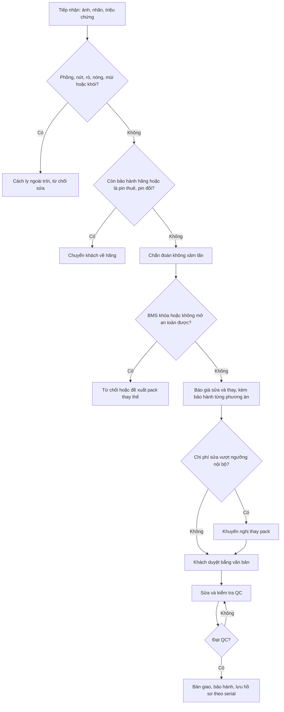
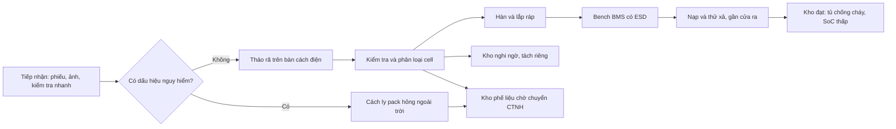
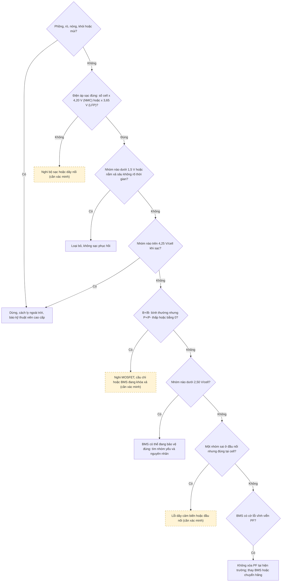
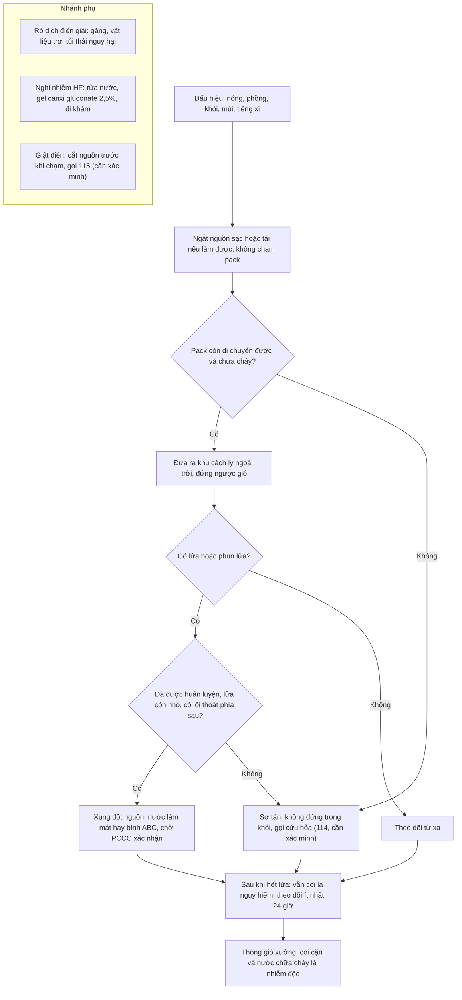
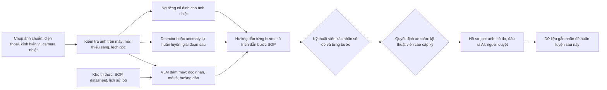

# Đo trước, sửa theo ngưỡng, cách ly pack hỏng

*Báo cáo tổng hợp từ năm ghi chú nghiên cứu, cập nhật đến 13/11/2026, cho xưởng sửa pin lithium có BMS tại Việt Nam, quy mô 1–10 kỹ thuật viên. Phần giá và pháp lý chủ yếu là dữ liệu thứ cấp hoặc quảng cáo. Phần cuối nêu mức tin cậy và các mâu thuẫn giữa nguồn.*

## Tóm tắt điều hành

- **Mở với danh mục hẹp.** Làm chẩn đoán, sửa đầu nối và dây, thay BMS thông dụng không khóa, thay một phần cell sau khi đo, và bán linh kiện có chứng từ. Từ chối pack phồng, nứt, rò, nóng hoặc có mùi, pack còn bảo hành hãng, và BMS độc quyền bị khóa. Không đưa "kích pin" pack xả sâu vào dịch vụ thường lệ.
- **Giá trên thị trường là giá quảng cáo.** Chẩn đoán 0–100.000 đồng, sửa lẻ xe đạp và xe máy điện 150.000–750.000 đồng, pack xe máy điện mới 6–12 triệu đồng. Quy tắc "sửa bằng 30–50% giá pack mới" không có nguồn kiểm chứng, nên xưởng cần đặt ngưỡng riêng.
- **Tách bảo hành theo hạng mục.** Thị trường tự do thường bảo hành 6–12 tháng cho việc sửa và 12–18 tháng cho pack thay mới, ngắn hơn bảo hành hãng nhiều. Pack còn bảo hành hãng phải chuyển về hãng ngay khi tiếp nhận.
- **Ba cấp thiết bị; số kênh thử là nút thắt.** Cấp khởi đầu khoảng 800–1.500 USD, chuyên nghiệp 3.000–6.000 USD, khối lượng lớn 15.000–35.000 USD. Các tổng này do người viết báo cáo cộng từ giá trích dẫn, không phải báo giá. Ưu tiên máy đo nội trở 4 dây xoay chiều, tủ kiểm dung lượng nhiều kênh, và kiểm nickel khi nhập kho.
- **Bố trí một chiều, pack hỏng ra ngoài trời.** Khu sạc và thử đặt gần cửa thoát, có bình chữa cháy và cảm biến khói, không sạc qua đêm. Kho pack đạt giữ ở SoC thấp.
- **Pháp lý chưa đủ rõ để mở ngay.** Nghị định 105/2025 đã thay Nghị định 136/2020 về PCCC, nhưng ngưỡng diện tích cho xưởng nhỏ và việc pin lithium có thuộc nhóm hàng dễ cháy chưa được xác nhận. Chủ xưởng cần hỏi công an PCCC địa phương và luật sư trước khi mở, và ký hợp đồng xử lý chất thải nguy hại trước khi nhận pack hỏng đầu tiên.
- **Nguồn chữa cháy mâu thuẫn.** Có nguồn khuyên dùng nước, có nguồn khuyên bình ABC, có nguồn khuyên không chữa mà sơ tán. Báo cáo không chọn một nguồn; quy trình ứng phó chờ PCCC địa phương xác nhận.
- **AI nhìn ảnh chỉ hỗ trợ.** Chưa có nghiên cứu nào về AI nhìn ảnh trong xưởng sửa pin, và các độ chính xác hiện có là cận trên. Trên câu hỏi "có lỗi hay không", mô hình ngôn ngữ thị giác tốt nhất đạt 68,6%, chuyên gia đạt 95,2%. Kỹ thuật viên cao cấp ký mọi quyết định an toàn.

## Mục đích 1: Dịch vụ, giá, bảo hành và quyết định sửa, thay hay từ chối

### Dịch vụ nên mở

Các cửa hàng Việt Nam thường gộp kiểm tra, sửa, đóng pack mới và bán linh kiện, như [Homesheel](https://homesheel.com.vn/sua-pin-xe-dien-homesheel/) và [PinShop](https://pinshop.vn/san-pham/dich-vu-dong-pin-xe-dien-xe-dap-dien-theo-yeu-cau-chat-luong-cao-an-toan-dung-chuan-ky-thuat/). Báo cáo chia thành các mức D0 đến D6 để chấm từng loại theo rủi ro.

| Mã | Dịch vụ | Khuyến nghị |
|---|---|---|
| D0 | Chẩn đoán không xâm lấn | Mở. Phí 0–100.000 đồng |
| D1 | Sửa đầu nối, dây, cầu chì | Mở |
| D1b | "Kích pin" pack xả sâu hoặc để lâu | Không đưa vào dịch vụ thường lệ |
| D2 | Thay BMS thông dụng, không khóa | Mở có điều kiện. Từ chối BMS bị khóa |
| D3 | Thay một phần cell, cân bằng | Mở có điều kiện. Cell phải đo và ghép |
| D4 | Re-cell toàn bộ, giữ vỏ | Mở có điều kiện. Tham chiếu Mỹ 300–600 USD; Việt Nam chưa có giá |
| D5 | Đóng pack mới, nâng dung lượng | Mở có điều kiện. Từ chối vượt thiết kế xe |
| D6 | Bán linh kiện, thu pin cũ | Mở. Linh kiện có CO/CQ |

"Kích pin" được nhiều cửa hàng quảng cáo cho xe VinFast và Dat Bike để lâu không dùng. Nhưng pack xả sâu có thể đã hình thành đồng trong cell, làm tăng tự xả và có thể đoản mạch bên trong ([Battery University](https://batteryuniversity.com/article/bu-808a-how-to-awaken-a-sleeping-li-ion)). Vì vậy, xưởng chỉ nên chẩn đoán các pack này. Cell dưới **1,5 V** hoặc pack không rõ thời gian nằm xả sâu phải loại bỏ. Khôi phục pack xả sâu cần một quyết định rủi ro riêng, ngoài phạm vi báo cáo.

Pack độ nâng dung lượng vượt thiết kế làm quá tải dây, motor và bộ điều khiển ([VietTimes](https://viettimes.vn/nguy-co-chay-no-rinh-rap-tu-pin-do-che-xe-may-dien-post188128.html)). Chưa có nguồn nào xác nhận quy chuẩn hay hợp quy bắt buộc cho pack tự đóng, nên D5 mang rủi ro pháp lý lớn.

### Giá và bảo hành

Giá dưới đây là niêm yết bán lẻ tại Việt Nam, không phải khảo sát độc lập. [F] nghĩa là đã đọc trang gốc; [S] nghĩa là chỉ có đoạn tóm tắt tìm kiếm.

| Hạng mục | Mức giá | Nguồn |
|---|---|---|
| Chẩn đoán | 0–100.000 đồng | Trang bán lẻ, [S] |
| Sửa pin hoặc BMS xe đạp, xe máy điện | 150.000–750.000 đồng | [suaxedienhcm.com](https://suaxedienhcm.com/), [S], gán nguồn chưa chắc |
| BMS 20–60A cho pack 48 V | 450.000–1.800.000 đồng, khoảng 1 ngày | [PinShop](https://pinshop.vn/san-pham/dich-vu-dong-pin-xe-dien-xe-dap-dien-theo-yeu-cau-chat-luong-cao-an-toan-dung-chuan-ky-thuat/), [F] |
| Thay pin xe máy điện mới | 6–12 triệu đồng | [Dichvu3T](https://dichvu3t.com/2025/10/04/sua-pin-va-thay-pin-xe-may-dien/), [F] |
| Pack đóng mới 36 V, 12–15 Ah | 2,8–4,2 triệu đồng | PinShop, [F], ngày niêm yết không rõ |
| Thay pin laptop | 400.000–2.500.000 đồng, khoảng 60 phút | [Điện Thoại Vui](https://dienthoaivui.com.vn/sua-chua-laptop/thay-pin-laptop/), [S] |

Cấu trúc giá tách thành phí chẩn đoán, vật tư (cell nhân đơn giá, cộng BMS), công theo cấp dịch vụ và phụ phí vỏ hoặc đầu nối. Thị trường quen với kiểm tra miễn phí, nên phí chẩn đoán phải được giải thích. Đề xuất của người viết là thử mô hình thu phí có khấu trừ khi sửa, rồi chọn mô hình có tỷ lệ khách duyệt cao hơn.

Quy tắc "sửa bằng 30–50% giá pack mới" chỉ có trong quảng cáo. Cách tính đáng tin hơn là so giá sửa với pack mới, số chu kỳ còn lại và số lần đã sửa. Ví dụ rebuild 400 USD khi pack tương thích mới giá 300 USD thì nên thay ([Upway](https://upway.co/blogs/news/how-much-does-it-cost-to-fix-an-ebike-battery)).

Bảo hành thị trường không đồng nhất. Homesheel ghi 12 tháng ở banner, 1–12 tháng trong nội dung và 13 tháng ở một ảnh, nên phiếu của xưởng cần ghi số tháng riêng cho từng hạng mục. Đề xuất khởi đầu: sửa đầu nối bảo hành 6 tháng và điều chỉnh theo tỷ lệ quay lại; pack thay mới bảo hành dài hơn. Điều khoản loại trừ như vào nước, sạc sai hay tự mở chưa được nguồn nào công bố, nên xưởng phải tự viết và khách phải xác nhận. Sửa pin có thể làm mất bảo hành hãng ([Dichvu3T](https://dichvu3t.com/2025/10/04/sua-pin-va-thay-pin-xe-may-dien/)), và phụ tùng không thay tại xưởng ủy quyền VinFast thì không được bảo hành ([PDF VinFast](https://static-cms-prod.vinfastauto.com/250528-xmd-lfp.pdf)).

### Quyết định sửa, thay hay từ chối

Quy trình gồm bảy bước và sáu điểm quyết định. DP1 là an toàn tức thời, DP2 là quyền sở hữu và bảo hành, DP3 là khả năng kỹ thuật, DP4 là kinh tế, DP5 là khách duyệt bằng văn bản, và DP6 là kết quả QC. Pack thuê hoặc đổi cần hỏi nguồn gốc khi tiếp nhận. VinFast có thể ngắt kết nối pin thuê từ xa nếu khách không trả đúng quy định ([VnReview](https://vnreview.vn/threads/vinfast-chinh-thuc-dung-hoan-toan-dich-vu-thue-pin-xe-may-dien-thu-hoi-pin-neu-khach-khong-mua.59904/latest)). Xưởng không nên mở khóa loại pin này.

Quy tắc tóm tắt: **sửa** khi lỗi cục bộ, cấu trúc còn tốt và chi phí dưới ngưỡng. **Thay** khi chai toàn bộ, đã sửa nhiều lần vẫn xuống nhanh, hoặc sửa vượt giá pack mới. Lithium thường hết tuổi thọ sau 5–8 năm ([Dichvu3T](https://dichvu3t.com/2025/10/04/sua-pin-va-thay-pin-xe-may-dien/)). **Từ chối** khi phồng, nứt, rò, nóng, mùi, BMS khóa, pack thuê hoặc đổi, hoặc yêu cầu vượt thiết kế xe. Thời gian xử lý thị trường là 2–5 ngày làm việc. Con số này chưa được đo thực tế. Pin lithium thường lâu hơn mốc 1–3 ngày của sửa điện thoại, do chu kỳ nạp xả và thời gian nghỉ.

## Mục đích 2: Thiết bị, bố trí, quy trình và an toàn

### Thiết bị theo cấp ngân sách

Bộ khởi đầu gồm máy đo nội trở 4 dây, máy kiểm dung lượng một kênh, máy hàn điểm tụ điện và bộ cân bằng. Bảng dưới đây liệt kê các món có giá trích dẫn. Giá ở Việt Nam là giá niêm yết qua nhiều nguồn, có món từ năm 2022 đến 2026.

| Chức năng | Thiết bị (ví dụ) | Giá đã trích dẫn | Độ tin cậy |
|---|---|---|---|
| Nội trở AC 1 kHz, 4 dây | YR1035+ | 950.000–1.750.000 đồng (Việt Nam) | [S]. Đánh giá độc lập: tốt, nhưng kẹp đi kèm yếu |
| Nội trở cao cấp | Hioki BT3554-50 | 3.160–3.484 USD (quốc tế) | [S]. Chỉ đo 6–60 V |
| Kiểm dung lượng một kênh | EBC-A20; EBC-A40L | 1.523.000–1.650.000 đồng (Việt Nam, 4/2024); 196–351 USD | [S]. Giá cũ, không đồng nhất |
| Cân bằng chủ động | NEEY 4 A | 1.750.000 đồng (Việt Nam) | [S] |
| Tủ phân loại 8 kênh | Nhà sản xuất Trung Quốc | 400–1.000 USD | [S]. Nhà bán tổng hợp |
| Kiểm dung lượng cả pack 20/40 A | Heltec | 640–680 USD | [S]. Tuyên bố tăng dung lượng của Heltec (cho bộ cân bằng) không có phương pháp |
| Hàn điểm tụ điện | Glitter 811A; 811H | 339–345 USD; 650–668 USD | [S]. Tuyên bố hàn nickel 0,3 mm |
| Hàn laser 1500 W | Nhiều hãng | 3.888–15.000 USD | [S]. Giới hạn khoảng 1 mm với đồng |
| Camera nhiệt cầm tay | InfiRay P2 Pro | Khoảng 230–300 USD | [S] |

Ba cấp đầu tư được tổng hợp dưới đây. Tổng là **roll-up của người viết**, cộng từ các giá trên và có dự phòng cho món chưa có giá. Không phải báo giá.

| Cấp | Quy mô | Thiết bị chính | Tổng (roll-up của người viết) |
|---|---|---|---|
| Khởi đầu | 1–2 kỹ thuật viên | Nội trở 4 dây, EBC-A20 hoặc A40L, NEEY 4 A, máy hàn tụ điện cỡ 811A, mạch UART | 800–1.500 USD |
| Chuyên nghiệp | 3–5 kỹ thuật viên | Thêm tủ 8 kênh, analyzer 24S, kiểm pack, máy hàn cỡ 811H | 3.000–6.000 USD |
| Khối lượng lớn | 6–10 kỹ thuật viên | Nhiều tủ hoặc 128 kênh, Hioki BT3554, laser tùy chọn | 15.000–35.000 USD |

Các món sau **chưa có nguồn nào về giá hoặc thông số**: đồng hồ vạn năng, nguồn DC lập trình, tải điện tử kiểu DL24, trạm hàn và khò, hút khói hàn, máy đo cách điện và camera nhiệt cố định. Các tổng trên không bao gồm chúng.

Một số lưu ý mua sắm có căn cứ:

- **Đo nội trở phải dùng 4 dây và 1 kHz xoay chiều**, đúng phương pháp datasheet của cell dùng. Pack 72 V cần máy đo đến 100 V như YR1035+, vì Hioki chỉ đo đến 60 V.
- **Kiểm nickel khi nhập kho.** Ở 5 A, nickel mạ thép có điện trở 192 mΩ so với 24 mΩ của nickel nguyên chất cùng độ dày. Một mẫu bán là nickel nguyên chất hóa ra là thép carbon ([electric-skateboard.builders](https://www.electric-skateboard.builders/t/carbon-steel-strip-vs-stainless-steel-strip-vs-pure-nickel-strip-fake-nickel-strips-tested-practical-performance-test-results/18633), [HOBBY]).
- **Máy hàn 1,5 kW kiểu biến áp có thể không đủ cho nickel 0,2–0,3 mm.** Đây là suy luận từ thông số. Máy tụ điện tách mối hàn khỏi lưới, nhưng chưa có thử nghiệm độc lập.
- **Laser 1500 W không đủ cho busbar đồng.** Busbar đồng cần cỡ 3000 W ([FindLight](https://www.findlight.net/uploads/products/datasheet/1500w-portable-laser-welding-machine_1665227263.pdf)).

Năng suất phụ thuộc số kênh hơn dòng định mức. Với cell 2,5 Ah sạc và xả 0,5C mất khoảng 5–6 giờ mỗi chu kỳ, tủ 8 kênh chỉ cho khoảng 8 cell mỗi ngày. Re-cell 10S4P cần 40 cell, tức khoảng 5 ngày làm việc. Đây là phép tính minh họa của người viết, không có nguồn.

### Bố trí khu vực và luồng vật liệu

Hướng dẫn chính thức duy nhất tìm được là cho cửa hàng xe đạp điện. Hướng dẫn đó yêu cầu kho chống cháy, trạm sạc có người trực, và pack hỏng để ngoài nhà ([HPS](https://www.bicycleretailer.com/sites/default/files/downloads/article/battery-protocols-v1.6.pdf)). Không có sơ đồ hay khoảng cách tối thiểu nào cho xưởng sửa pin, nên sơ đồ dưới đây là suy ra từ nguyên tắc luồng một chiều.

- **Cách ly ngoài trời** cho pack phồng, ướt, bẹp, 0 V hoặc rò. Không đặt cạnh cửa thoát.
- **Bench BMS** là khu duy nhất có thảm tiêu tán tĩnh điện và vòng tay ESD. Thảm này hơi dẫn điện nên không đặt dưới cell hở. Không nguồn nào xử lý mâu thuẫn giữa ESD và cách điện, và đây là suy luận.
- **Nạp và thử** dùng xe đẩy kim loại, có ổ cắm có công tắc, đặt dưới cảm biến khói và cạnh bình ABC. Không sạc qua đêm. Thời gian thử giới hạn bởi số giờ có người trực nhân số kênh.
- **Tủ chống cháy** cần chứng nhận rõ chiều lửa. EN 14470-1 chỉ thử từ ngoài vào trong. Đánh giá từ trong ra ngoài là của nhà cung cấp ([DENIOS](https://www.denios.co.uk/consulting-planning/denios-magazine/guide-to-battery-cabinets-for-lithium-ion-batteries)).

### Cây quyết định cô lập lỗi BMS

Cây dưới đây chỉ để cô lập lỗi, không phải thủ tục sửa mạch. Nút có viền đứt dùng suy luận hoặc nguồn hobby, và cần xác minh trước khi đưa vào quy trình chính thức. Các ngưỡng đều có nhãn nguồn trong bảng sau cây.

| Ngưỡng | Giá trị | Nguồn | Mức tin cậy |
|---|---|---|---|
| Điện áp sạc NMC | 4,20 V/cell, dung sai ±50 mV | [BU-409](https://batteryuniversity.com/article/bu-409-charging-lithium-ion) | [REF] |
| Điện áp sạc LFP | 3,65 V/cell | BU-409 | [REF] |
| Ngưỡng xả tối thiểu của Li-ion | 2,50 V/cell | [BU-802b](https://batteryuniversity.com/article/bu-802b-what-does-elevated-self-discharge-do) | [REF] |
| Cell không vượt 4,25 V khi sạc; mạch bảo vệ ngắt trước 4,30 V | | [BU-803a](https://batteryuniversity.com/article/bu-803a-cell-matching-and-balancing), [BU-304b](https://batteryuniversity.com/article/bu-304b-making-lithium-ion-safe) | [REF] |
| Cell dưới 1,5 V đã nằm lâu từ một tuần: không sạc tăng áp | | [BU-808a](https://batteryuniversity.com/article/bu-808a-how-to-awaken-a-sleeping-li-ion) | [REF]. Việc loại bỏ là suy luận |
| Sạc an toàn | 0–45 °C; không sạc dưới 0 °C | [BU-410](https://batteryuniversity.com/article/bu-410-charging-at-high-and-low-temperatures) | [REF] |
| Ngưỡng cắt thấp áp của mạch bảo vệ | 2,2–2,9 V/cell tùy hãng | BU-808a | [REF]. Đối chiếu datasheet BMS |
| Cân bằng LFP | Dưới 50 mV là cân bằng; trên 150 mV cần cân bằng lại | [DIY Solar Forum](https://www.diysolarforum.com/resources/top-balancing-lifepo4-cells-using-a-low-cost-benchtop-power-supply.65/) | [HOBBY] |
| Chênh lệch nhóm khi nghỉ (NMC); nội trở loại khi gấp đôi giá trị đầu | Không có giá trị chuẩn | Không có nguồn | Cần xác minh. Xưởng tự đặt ngưỡng và ghi là quy tắc nội bộ |

Hai điểm cần nói rõ. Thứ nhất, cây không bao gồm thủ tục thay đổi ngưỡng bảo vệ để kích hoạt hoặc tắt bảo vệ. Kiểm tra chức năng bảo vệ phải theo tài liệu hãng BMS và do kỹ thuật viên cao cấp thực hiện. Thứ hai, các nguồn mâu thuẫn về cell dưới 1,5 V. Samsung công bố cửa sổ sạc trước từ 1,0 V đến 3,0 V ([bản sao Scribd, cần kiểm lại](https://www.scribd.com/document/676224823/ACCU-INR18650-29E)), còn Battery University yêu cầu loại bỏ cell nằm sâu quá một tuần. Báo cáo đề xuất lấy quy tắc thận trọng của BU làm mặc định, và đây là lựa chọn của người viết.

Với BMS thông minh, bộ đo TI BQ40Z50 khi gặp lỗi vĩnh viễn (PF) sẽ tắt FET và có thể làm nổ cầu chì hóa học. Xóa PF cần khóa unseal của hãng, và TI không khuyến nghị unseal tại hiện trường ([TI SLUUCN4](https://www.ti.com/lit/pdf/SLUUCN4)). Với pack OEM đã bị PF, thay BMS hoặc chuyển về hãng là hướng thực tế.

### Quy trình chuẩn và cổng kiểm soát chất lượng

Quy trình tám bước dưới đây do người viết ghép từ các nguồn về pack đóng, chẩn đoán và QC. Không cửa hàng nào công bố đầy đủ như vậy. Năm cổng G0 đến G5 là điểm dừng bắt buộc.

| Bước | Nội dung | Cổng | Tiêu chí |
|---|---|---|---|
| 1. Tiếp nhận | Phiếu, nhãn, ảnh, triệu chứng, nguồn gốc | G0 | Phồng, nứt, rò, nóng, mùi thì cách ly hoặc từ chối |
| 2. Chẩn đoán không xâm lấn | Điện áp pack, đầu ra, đọc BMS | G1 | Khách duyệt báo giá bằng văn bản |
| 3. Mở và lập bản đồ | Điện áp và nội trở từng nhóm, quan sát | | Quyết định: lỗi BMS, đầu nối, nhóm yếu, hay re-cell |
| 4. Tháo và thu cell | Chỉ khi cần | | Cell loại đi thùng chất thải nguy hại |
| 5. Kiểm tra cell theo lô | Sạc, nghỉ, dung lượng, nội trở, phân nhóm | G2 | Dung sai dung lượng khi ghép ±2,5% ([REF]). Kiểm nickel khi nhập |
| 6. Lắp ráp | Đồ gá, cách điện, hàn điểm, dây | G3 | Test kéo mẫu: mối hàn rách vật liệu trước khi bung ([HOBBY]) |
| 7. Cân bằng và kiểm cấp pack | Sạc đầy, xả ở dòng xác định, chênh lệch nhóm, nhiệt | G4 | Xem dưới đây |
| 8. Đóng và bàn giao | Nhãn job, ảnh, phiếu kết quả, SoC thấp khi lưu | G5 | Kỹ thuật viên cao cấp ký |

G4 yêu cầu điện áp B+/B- bằng P+/P- sau khi kích hoạt; chênh lệch nhóm trong ngưỡng nội bộ; dung lượng đạt ít nhất 80% danh định (nguồn blog và nhà bán, không phải tiêu chuẩn); và cách điện ít nhất 5 MΩ giữa cực pack và vỏ kim loại lộ ra. Con số 5 MΩ chỉ đến từ một báo cáo IEC 62133-2 của bên thứ ba, nên chỉ dùng làm mức sàn. Không có nguồn nào đưa ra ngưỡng chênh lệch nhóm, mức tăng nhiệt cho mối hàn, hay thời gian giữ để tự xả.

Hồ sơ tối thiểu cho từng pack gồm mã job trên pack và khay linh kiện, ảnh trước và sau, bảng điện áp từng nhóm lúc tiếp nhận và lúc trả, lô và nhóm cell, cài đặt máy hàn, model BMS và bản xuất thông số. Hồ sơ này cũng là cơ sở giải quyết tranh chấp bảo hành.

### Mối nguy và kiểm soát

Mối nguy lớn nhất là thermal runaway, gây cháy, nổ và khí độc. Mối nguy thứ hai là hồ quang khi ngắn mạch, bỏng và dịch điện giải. Pack 72 V vượt ngưỡng 60 V DC mà UN R100 dùng để phân loại điện áp cao ([EUR-Lex](https://eur-lex.europa.eu/eli/reg/2015/100/oj/eng/pdf)). R100 là quy định phê duyệt xe, nên đây là chuẩn thiết kế chứ không phải giới hạn cho xưởng. Isopropyl alcohol có điểm chớp cháy khoảng 12 °C ([NIOSH](https://webarchive.library.unt.edu/eot2008/20081108192822/http://www.cdc.gov/niosh/npg/npgd0359.html)), nên không để gần máy hàn hay mỏ hàn.

| Mối nguy | Kiểm soát kỹ thuật | Kiểm soát quy trình | Bảo hộ |
|---|---|---|---|
| Thermal runaway | Tủ chống cháy, cảm biến khói và nhiệt, bộ sạc giới hạn dòng | Sạc có người trông, không qua đêm, không sạc pack hỏng | Kính hoặc mặt nạ, quần áo không tan chảy |
| Hồ quang, bỏng | Mặt bàn không dẫn điện, dụng cụ cách điện theo IEC 60900 | Tháo trang sức kim loại, bọc đầu cực | Kính; găng cách điện (cấp chưa xác minh) |
| Điện giật trên 60 V DC | Chắn, nguồn có ngắt | Chia pack dưới 60 V khi làm việc (suy luận) | Găng theo IEC 60903 (cấp chưa xác minh) |
| Khí độc, dịch điện giải | Hút khí cục bộ, thông gió, vòi rửa mắt | Sơ tán khi có khói; bỏ cell rò vào túi riêng | Mặt nạ cho người đã huấn luyện; găng nitrile |

OSHA yêu cầu vòi rửa mắt nơi có thể tiếp xúc dịch điện giải ([OSHA](https://www.osha.gov/lithium-ion-battery-safety/control)). Danh sách PPE trên là thực hành chung, vì OSHA không nêu PPE cụ thể.

### Cháy nổ: phòng ngừa và ứng phó

Khi thermal runaway đã bắt đầu, chưa có kỹ thuật nào được thử nghiệm để dừng hẳn. Trong thử nghiệm với xe điện của UL FSRI, nước là lựa chọn đầu tiên và chất phụ gia không hiệu quả hơn nước ([FSRI](https://fsri.org/research-update/researchers-release-evidence-based-ev-battery-fire-response-considerations)). Khí HF là mối nguy đi kèm: thử nghiệm bảy loại cell thương mại cho 20–200 mg HF mỗi Wh ([Larsson et al.](https://www.ncbi.nlm.nih.gov/pmc/articles/PMC5577247/)). Số này lấy từ luận án và tóm tắt, chưa đối chiếu bảng gốc. Suy luận của người viết: một pack 1 kWh cháy hết có thể thoát 20–200 g HF.

Tại Việt Nam, cảnh sát PCCC (C07) cho rằng sạc là nguyên nhân chính trong các vụ cháy xe điện, với mối hàn và đầu nối kém là yếu tố phụ ([SGGP](https://www.sggp.org.vn/bo-cong-an-khuyen-cao-sac-xe-dien-an-toan-han-che-chay-no-post698917.html)). Vụ cháy Trung Kính, Hà Nội, ngày 24/5/2024 làm 14 người chết, trong ngôi nhà vừa ở, vừa cho thuê, vừa kinh doanh xe điện. Công an công bố nguyên nhân là đoản mạch điện ở đầu một xe máy điện, lửa chặn lối thoát duy nhất ([PLO](https://plo.vn/cong-an-tp-ha-noi-cong-bo-nguyen-nhan-chay-o-pho-trung-kinh-post797557.html)). Kết luận nêu dây điện, không nêu cell lithium. Bài học cho xưởng là không ở chung nơi làm việc, không để xe và pack trên lối thoát, và có lối thoát thứ hai.

Các nguồn không thống nhất về chất chữa cháy:

| Nguồn | Khuyến nghị | Ghi chú |
|---|---|---|
| FSRI (xe điện) | Nước là lựa chọn đầu tiên | Thử nghiệm xe, không phải xưởng |
| NFCC (Anh), London Fire Brigade | Không dập lửa; ra ngoài, gọi cứu hỏa | Dành cho người không được huấn luyện |
| OSHA (SHIB 2019) | Bình ABC, Class D, cát hoặc đất | Class D dành cho lithium kim loại |
| UVA và OSU EHS | Bình ABC hoặc nước đều dùng được với Li-ion | Hướng dẫn đại học |
| HPS (cửa hàng xe đạp) | Thùng 120 L đựng nước để ngâm pack hỏng, kèm bình ABC | Thực hành cửa hàng |
| Tài liệu an toàn xưởng (trang bán hàng) | Không dùng nước; cần Class D | Mâu thuẫn với HPS |
| Kiwa, qua tài liệu hãng | F-500 hiệu quả nhất | Nguồn nhà sản xuất, mâu thuẫn với FSRI |

Các nguồn đồng ý ở một điểm: giảm thiểu và sơ tán được ưu tiên hơn chữa cháy. Quy trình tạm thời của báo cáo là: khi có dấu hiệu nóng, phồng, khói hoặc mùi, ngắt nguồn nếu làm được mà không chạm pack, rồi đưa pack ra khu cách ly khi còn di chuyển được. Nếu đã có lửa, sơ tán và gọi cứu hỏa. Chỉ chữa khi lửa còn nhỏ, người chữa đã được huấn luyện và có lối thoát phía sau. Việc chọn bể nước, bình ABC hay chất khác phải chờ PCCC địa phương xác nhận.

Thời gian theo dõi 24 giờ là suy luận từ hướng dẫn về nguy cơ bốc cháy lại trong 24–72 giờ. Số 114 và 115 là kiến thức nền, chưa có nguồn xác nhận.

### Sơ cứu, lưu trữ và chất thải

Với HF, hướng dẫn phổ biến là rửa nước khoảng 5 phút, thoa gel canxi gluconate 2,5% và thay gel mỗi 15 phút cho đến khi có y tế ([Virginia Tech](https://ehs.vt.edu/content/dam/ehs_vt_edu/first-aid-cpr-aed/hydrofluoric%20acid%20quick%20response.pdf)). Các hướng dẫn này viết cho HF trong phòng thí nghiệm. Ở xưởng pin, ca phổ biến hơn là kích ứng do dịch điện giải và hít khói. Với mắt, Stanford yêu cầu ít nhất 15 phút ([Stanford](https://ehs.stanford.edu/?p=815)), còn Cornell nêu 5 phút hoặc 15–30 phút. Với điện giật và bỏng, không có bước sơ cứu có nguồn; xưởng cần lấy bước cụ thể từ bảng dữ liệu an toàn của cell.

Hướng dẫn cửa hàng khuyên SoC không quá 30% khi lưu kho ([Battery Network](https://batterynetwork.org/wp-content/uploads/E-Bike-Battery-Safety-A-Guide-for-Retailers-The-Battery-Network.pdf)), còn [Chubb](https://www.chubb.com/au-en/brokers/risk-bulletins/lithium-ion-batteries-storage.html) khuyên 30–50% và [Towergate](https://www.towergateinsurance.co.uk/insight/how-to-correctly-store-lithium-ion-batteries) khuyên 30–60%. Báo cáo đề xuất kho đạt ở mức 30%, trừ khi nhà sản xuất cell yêu cầu khác (suy luận). Pack hỏng không để trong tủ sạc hay trong cửa hàng, và không gửi hàng không. ADR SP 376 yêu cầu đóng gói có đệm không cháy, không dẫn điện và nhãn "DAMAGED/DEFECTIVE" ([The Compliance Center](https://www.thecompliancecenter.com/how-to-ship-damaged-or-defective-lithium-batteries/)). DHL không nhận pin hỏng ([DHL](https://mydhl.express.dhl/vn/vi/help-and-support/shipping-advice/what-can-i-ship/lithium-batteries.html)), nên xưởng nên thu pack hỏng tại quầy.

Pin thải là chất thải nguy hại theo Thông tư 02/2022/TT-BTNMT, sửa bởi Thông tư 07/2025/TT-BTNMT. Xưởng là chủ nguồn thải: phải phân loại, lưu riêng, ký hợp đồng với đơn vị có giấy phép và lưu chứng từ. **Mã chất thải cho pin lithium chưa xác nhận.** Một nghiên cứu ghi 16 01 12, còn công bố của Toyota ghi 19 06 02 và 19 06 05 ([Toyota VN](https://www.toyota.com.vn/media/qhehbmrh/thông-tin-về-các-hạng-mục-thực-hiện-trách-nhiệm-tái-chế-của-công-ty-ô-tô-toyota-việt-nam.pdf)). Cần đọc Phụ lục III trước khi ký hợp đồng.

### Pháp lý: trạng thái theo ghi chú

Phần lớn nội dung dưới đây đối chiếu qua báo chí và công ty luật, chưa đọc văn bản gốc. Nghị định 105/2025 (hiệu lực 1/7/2025) đã thay Nghị định 136/2020, nhưng Điều 46 giữ lại một số quy định cũ.

| Nội dung | Tình trạng theo ghi chú | Mức chắc chắn |
|---|---|---|
| Ngưỡng diện tích, phụ lục I | Mục 11 "dịch vụ khác" từ 100 m² (công văn C07, 30/1/2026); mục 12 hàng dễ cháy từ 30 m²; mục 32 nhà ở kết hợp kinh doanh từ 50 m² | **Chưa xác nhận** cho xưởng pin |
| Pin lithium có là "hàng dễ cháy" không | Chưa xác định | **Chưa xác nhận** |
| Đội PCCC cơ sở | Cơ sở từ 20 người làm việc thường xuyên | Nguồn tóm tắt; với 1–10 kỹ thuật viên cần xác nhận |
| Quy chuẩn pin xe máy điện | QCVN 31:2026/BXD thay QCVN 91:2024/BGTVT, hiệu lực 9/10/2026 theo báo | **Chưa xác nhận**; áp dụng cho pin sản xuất, nhập khẩu mới |
| EPR | NĐ 110/2026 (25/5/2026), một nguồn tin; tỷ lệ tái chế pin lithium xe vận tải 0% | **Chưa xác nhận**. Xưởng là người thải, không phải bên có nghĩa vụ EPR |
| Bảo hiểm cháy nổ bắt buộc | 44 loại cơ sở từ 1/7/2025 | Chưa kiểm tra xưởng có thuộc diện không |

Pack tự đóng bán ra thị trường là khoảng trống lớn: chưa có nguồn nào về quy chuẩn hay hợp quy bắt buộc. NĐ 161/2024 xếp pin lithium-ion là hàng nguy hiểm loại 9 ([LSVN](https://lsvn.vn/bo-cong-an-khuyen-cao-giai-phap-bao-dam-an-toan-va-trach-nhiem-phap-ly-trong-van-chuyen-pin-lithium-ion-dung-luong-lon-a177043.html)). Quy định vận tải nội địa chưa được nghiên cứu.

**Trước khi mở cửa, chủ xưởng phải làm ba việc.** Hỏi công an PCCC địa phương về diện tích, phân loại pin, trang bị và chất chữa cháy được phép. Hỏi luật sư về hợp đồng dịch vụ, bảo hành, trách nhiệm chất thải và việc đóng pack. Ký hợp đồng xử lý chất thải nguy hại trước khi nhận pack hỏng đầu tiên.

## Mục đích 3: AI nhìn ảnh giúp kỹ thuật viên, chưa thay được phán quyết

### Bằng chứng: AI nhận diện được gì và đúng đến đâu

Chưa có nghiên cứu nào về AI nhìn ảnh trong xưởng sửa pin, cũng không có nghiên cứu nào về cell đã qua sử dụng hay BMS đã lắp. Các con số dưới đây đến từ ảnh nhà máy hoặc benchmark, nên **chỉ là cận trên** cho điều kiện xưởng.

| Bằng chứng | Kết quả | Ý nghĩa cho xưởng |
|---|---|---|
| Lỗi trên mạch trần | 96–99% mAP@0,5 ([PCB-YOLO](https://mdpi.com/2079-9292/14/17/3383)) | Chỉ là bo trần; không áp dụng cho BMS đã lắp |
| Lỗi cell (vỏ, rỉ, bẹp) | 80–94% mAP trên dây chuyền | Chưa thử trên cell cũ |
| VLM tốt nhất trên MMAD (GPT-4o) | "Có lỗi không" 68,6%; chuyên gia 95,2% ([MMAD](https://arxiv.org/html/2410.09453v3)) | Người vẫn tốt hơn rõ rệt |
| Đọc số trên đồng hồ | Khoảng 30% độ chính xác giá trị ([MeasureBench](https://arxiv.org/abs/2510.26865v1)) | Không tin số đọc từ ảnh |
| Cảnh báo nhiệt | ROC-AUC 1,00 với sự kiện mô phỏng ([arXiv](https://arxiv.org/html/2504.08632v2)) | Tác giả nói dữ liệu có thể quá dễ |

VLM nhận biết vật thể tốt hơn nhiều so với đánh giá lỗi (94,98% với GPT-4o). AI vì vậy phù hợp nhất với đọc nhãn, mô tả và hướng dẫn từng bước, không phải phán quyết đạt hoặc không đạt. Ánh sáng và góc chụp quan trọng hơn lựa chọn mô hình: vỏ 18650 phản chiếu mạnh, và một nghiên cứu phải dùng nguồn laser dạng đường để có ảnh lỗi đáng tin ([Informatica](https://www.informatica.si/index.php/informatica/article/view/7556/6314)).

### Các khâu nên dùng AI đến đâu

| Khâu | AI làm gì | Người quyết định |
|---|---|---|
| Tiếp nhận | Đọc nhãn, trích model, điện áp, dung lượng vào phiếu | Kỹ thuật viên xác nhận từng trường |
| Chẩn đoán | Ghi ảnh màn hình đo; gợi ý bước kế tiếp theo SOP | Kỹ thuật viên nhập lại số đo |
| Kiểm BMS, PCB | Đánh dấu linh kiện nghi cháy; đọc ký hiệu MOSFET (yếu với bo đã lắp) | Kỹ thuật viên |
| Phân loại cell | Đánh dấu vỏ móp, rỉ, rò như bước sàng lọc trước đo điện | Đo điện và kỹ thuật viên |
| QC cuối | Checklist ảnh bắt buộc; ảnh nhiệt khi tải | Kỹ thuật viên cao cấp ký |

Nguyên tắc thiết kế: dữ liệu chắc chắn (số đo, SOP, datasheet) cung cấp sự kiện, còn AI giải thích và sắp xếp các bước. Trong MMAD, mô tả đúng bằng văn bản làm tăng độ chính xác 25–28 điểm, nhưng đó là điều kiện lý tưởng không đạt được trong xưởng. Với mô hình mở, truy xuất kiến thức lĩnh vực tăng 5–7 điểm tổng thể và 17–20 điểm ở phân loại lỗi. AI nên trả lời từ SOP và số đo đã nhập, và trích đúng bước SOP đã dùng.

### Chi phí, phần cứng và quyền riêng tư

Chi phí API không phải điểm nghẽn. Theo bảng giá của Anthropic, Haiku 5.5 là 0,10 USD đầu vào và 0,50 USD đầu ra mỗi triệu token, Sonnet 5.5 là 2 USD và 10 USD ([bảng giá](https://platform.claude.com/en/docs/about-claude/pricing), tháng 11/2026). Một ảnh 1000×1000 px khoảng 1.296 token đầu vào và khoảng 500 token đầu ra, tức khoảng 0,0004 USD mỗi ảnh với Haiku và 0,008 USD với Sonnet (phép tính của người viết; báo cáo không khuyến nghị nhà cung cấp cụ thể). Phần cứng giai đoạn đầu chỉ cần điện thoại có sẵn và một camera nhiệt cầm tay khoảng 230–300 USD ([AnandTech](https://at-web1.www.anandtech.com/show/21200/infiray-p2-pro-and-topdon-tc001-thermal-cameras-capsule-review)).

Luật Bảo vệ dữ liệu cá nhân 91/2025/QH15 có hiệu lực từ 1/1/2026 ([GVLawyers](https://gvlawyers.com.vn/wp-content/uploads/2025/09/EN_Legal-alert-_Law-on-PDP-2025.pdf)). Ảnh pack thường không phải dữ liệu cá nhân, nhưng phiếu có tên, số điện thoại và biển số thì có. Theo một nguồn thứ cấp, chuyển dữ liệu ra nước ngoài cần hồ sơ đánh giá tác động gửi Bộ Công an trong 60 ngày ([Baker McKenzie](https://connectontech.bakermckenzie.com/?p=5530)). Gói API trả phí không dùng dữ liệu để huấn luyện, còn gói miễn phí của Gemini thì có ([Gemini](https://aistudio.google.com/docs/pricing)). Xưởng nên bỏ mã khách khỏi ảnh và prompt gửi ra nước ngoài, và lưu bản gốc trên máy của mình.

### Kiểm soát con người

- Kỹ thuật viên giữ các quyết định sau: tuyên bố pack an toàn để trả khách; chấp nhận hoặc loại cell có dấu hiệu phồng, rò, hư hại do nhiệt hoặc xả sâu; đánh giá độ bền mối hàn; mọi thay đổi ngưỡng bảo vệ BMS; giám sát sạc; quyết định cách ly hoặc thải bỏ.
- AI chỉ được đánh dấu để xem xét, không được tự xóa một mục an toàn. Với lớp an toàn, ưu tiên độ nhạy và chấp nhận báo động giả; với đọc nhãn, ưu tiên độ chính xác và buộc xác nhận.
- Trước khi tin một chức năng, chạy chế độ bóng trên vài trăm job thật, lấy kết luận của kỹ thuật viên cao cấp làm chuẩn, và kiểm lại sau mỗi lần đổi mô hình hoặc prompt. Ngưỡng tối thiểu phải đặt trước khi thử.

### Nhân sự: rút ngắn đào tạo, không phải cắt giảm

Bằng chứng định lượng chặt chẽ nhất đến từ hỗ trợ khách hàng, không phải sửa chữa. Nghiên cứu của [Brynjolfsson, Li và Raymond](https://www.nber.org/papers/w31161) cho thấy trợ lý AI tăng số vấn đề giải quyết mỗi giờ thêm 14% trung bình và 34% với nhân viên mới, nhưng gần như không ảnh hưởng người giỏi. Trong bảo trì, hướng dẫn AR cho kết quả nhanh hơn 20–30% và ít lỗi hơn 15–25%, nhưng đây là trích dẫn thứ cấp dùng trong doanh nghiệp lớn. Các con số tiếp thị như "cắt 60% thời gian đào tạo" bị loại khỏi báo cáo.

Kết luận hợp lý là AI có thể rút ngắn thời gian để người mới làm đúng các bước chuẩn hóa như tiếp nhận, chụp ảnh, phân loại cell và checklist QC, đồng thời giảm lỗi. **Các con số này chưa được kiểm chứng cho sửa pin**, và không có bằng chứng nào về số người một giám sát viên quản lý được. Thí điểm cần đo tỷ lệ làm lại, số lần gọi người giỏi ngắt quãng trên mỗi job, thời gian mỗi job, và thời gian để người mới làm được job chuẩn không cần hỗ trợ.

### Lộ trình AI theo giai đoạn

| Giai đoạn | Thời gian (giả định) | Phạm vi | Kỳ vọng chính xác | Rủi ro chính |
|---|---|---|---|---|
| 0. Chuẩn hóa | 2–4 tuần | SOP tiếng Việt, ảnh bắt buộc, góc chụp có ánh sáng | Không áp dụng | SOP không được tuân thủ |
| 1. Phiếu số và VLM đám mây | 1–3 tháng | Checklist bắt buộc, nhật ký ảnh, VLM đọc nhãn và hỏi đáp SOP | Đọc tốt nhưng phải xác nhận; lỗi có/không khoảng 60–75% khi không hỗ trợ | Đọc sai mã; quyền riêng tư |
| 2. Detector tự huấn luyện | Tháng 4–9 | YOLO cho vài lớp lỗi cell và BMS; xuất LiteRT chạy offline | Nhà máy 80–98% mAP; thấp hơn trên linh kiện cũ | Ít mẫu lỗi; giấy phép AGPL |
| 3. Giám sát cố định | Từ tháng 9 | Camera nhiệt trên bench sạc và thử, cảnh báo theo ngưỡng | Còn ở giai đoạn nghiên cứu | Báo động giả; dựa vào camera thay PCCC |

Giấy phép Ultralytics là AGPL-3.0; sản phẩm đóng hoặc dịch vụ thương mại cần giấy phép Enterprise có giá không công khai ([Ultralytics](https://www.ultralytics.com/license)). Trước giai đoạn 2, xưởng phải quyết định dùng mã mở hay trả phí.

## Lộ trình triển khai theo giai đoạn

Thời gian các giai đoạn là giả định của người viết, không có nguồn. Mỗi giai đoạn có một điều kiện để chuyển tiếp.

1. **Giai đoạn 0: pháp lý và mặt bằng.** Hỏi PCCC và luật sư, ký hợp đồng chất thải, kiểm tra bảo hiểm, xây khu cách ly ngoài trời và tủ chống cháy, viết SOP v1. *Chuyển tiếp khi:* có văn bản trả lời của PCCC và hợp đồng chất thải.
2. **Giai đoạn 1: mở với D0 đến D2.** Chẩn đoán, sửa đầu nối, thay BMS thông dụng, bán linh kiện; ghi phiếu có ảnh và đo KPI nền. *Chuyển tiếp khi:* đủ số job để đánh giá và mọi sự cố an toàn đều được ghi lại.
3. **Giai đoạn 2: thêm D3, D4, cấp chuyên nghiệp, AI giai đoạn 0 đến 1.** Thêm tủ 8 kênh, kiểm nickel nhập kho, thí điểm VLM ở chế độ bóng. *Chuyển tiếp khi:* kết quả bóng đạt ngưỡng đặt trước và tỷ lệ làm lại trong ngưỡng nội bộ.
4. **Giai đoạn 3: detector và giám sát cố định.** Chỉ mở rộng khi tỷ lệ báo động giả đã được đo. Cấp khối lượng lớn chỉ xét khi số kênh thử là nút thắt đã đo được.

KPI đề xuất: tỷ lệ sửa được ngay lần đầu, tỷ lệ quay lại theo loại lỗi, thời gian làm và thời gian chờ, tỷ lệ pack kiểm đủ ba test, tỷ lệ cell loại ở G2, và sự cố. Mốc 80–90% sửa ngay lần đầu chỉ là tham chiếu từ ngành điện tử và blog.

## Rủi ro chính và cách giảm

Mức độ là đánh giá của người viết, dựa trên bằng chứng trong ghi chú.

| Rủi ro | Bằng chứng | Mức độ | Biện pháp |
|---|---|---|---|
| Cháy và khí HF | 41 vụ cháy liên quan phương tiện pin tại TP.HCM, 10/2024 đến 10/2025 ([SGGP](https://www.sggp.org.vn/phong-chong-chay-no-phuong-tien-chay-bang-pin-chu-dong-trong-lo-trinh-xanh-post823330.html)) | Cao | Cách ly ngoài trời, không sạc qua đêm, cảm biến khói, bình ABC, lối thoát thứ hai |
| Pháp lý PCCC | Ngưỡng diện tích chưa xác nhận; Trung Kính là mẫu của xưởng kết hợp nơi ở | Cao | Hỏi PCCC và luật sư trước khi mở; không ở chung nơi ngủ |
| Cell giả, nickel mạ thép | Điện trở cao gấp khoảng 8 lần; cảnh báo của người bán | Cao | Kiểm nhập bằng tia lửa và đo 4 dây; ghi lô |
| Pack độ, điện giật 72 V | Báo chí; chưa có quy chuẩn cho pack tự đóng; UN R100 | Cao | Từ chối vượt thiết kế; dụng cụ cách điện; chia pack khi làm việc |
| Chất thải không có đầu ra | Tái chế pin xe 0%; mã chưa xác nhận | Trung bình | Hợp đồng trước khi nhận pack hỏng; dự trù chi phí |
| Khóa BMS, tranh chấp bảo hành | VinFast ngắt pin thuê từ xa; điều khoản loại trừ chưa công bố | Trung bình | Hỏi nguồn gốc; không mở khóa; phiếu ghi rõ, khách ký |
| AI đọc sai hoặc bỏ sót lỗi | Lỗi có/không 68,6% trên MMAD; đọc số khoảng 30% | Cao nếu không kiểm soát | Kỹ thuật viên xác nhận; chế độ bóng; AI không xóa mục an toàn |
| Quyền riêng tư, báo động giả | Luật 91/2025; báo động sai của mô hình giám sát an toàn ([AIMS](https://aimspress.com/aimspress-data/electreng/2025/3/PDF/electreng-09-03-013.pdf)) | Trung bình | Bỏ mã khách khỏi ảnh gửi đi; camera bắt đầu bằng ngưỡng đơn giản |

## Kết luận và việc nên làm trước

Mô hình khả thi nhất cho xưởng 1–10 kỹ thuật viên là chẩn đoán và sửa có giới hạn, đầu tư theo cấp khởi đầu, và coi khu cách ly, lưu trữ và chất thải là điều kiện tiên quyết. Thay cell có đo lường là hướng tăng trưởng, nhưng chỉ sau khi đủ kênh thử và kiểm nhập. AI nên bắt đầu từ việc chuẩn hóa như đọc nhãn, checklist và hướng dẫn từng bước, với kỹ thuật viên cao cấp ký mọi quyết định an toàn.

Việc đầu tiên là hỏi công an PCCC địa phương và một luật sư, vì báo cáo này không thay thế tư vấn pháp lý. Với PCCC, cần hỏi diện tích áp dụng, phân loại pin lithium, trang bị chữa cháy và chất chữa cháy được phép. Với luật sư, cần rà hợp đồng dịch vụ, bảo hành, trách nhiệm chất thải và việc đóng pack.

## Mức độ tin cậy và khoảng trống

### Nhãn nguồn

- **Giá và dịch vụ:** [F] đã đọc trang gốc; [S] chỉ có đoạn tóm tắt, URL có thể gán lệch. Hầu hết là trang bán hàng tự quảng cáo.
- **An toàn và BMS:** [REF] Battery University, tham khảo uy tín nhưng không phải tiêu chuẩn; [MFR/STD] nhà sản xuất hoặc tiêu chuẩn; [HOBBY] diễn đàn và blog.
- **AI:** [STUDY] bài báo, nhưng là ảnh nhà máy hoặc benchmark; [OFFICIAL] giá và thông số nhà cung cấp; [VENDOR CLAIM] tiếp thị; [SECONDARY] tóm tắt chưa kiểm.
- **Pháp lý:** phần lớn chưa đối chiếu văn bản gốc.

### Mâu thuẫn giữa các nguồn

| Chủ đề | Các nguồn | Cách báo cáo xử lý |
|---|---|---|
| **Chất chữa cháy** | FSRI, NFCC, OSHA, UVA, HPS, tài liệu thương mại, Kiwa | Không chọn; chờ PCCC địa phương |
| **Ngưỡng nội trở loại cell** | Khoảng 20–40 mΩ khi mới và loại trên 60 mΩ với chuỗi (thứ cấp); dưới 100 mΩ (blog hobby); tối đa 35 mΩ (Samsung 35E); gấp đôi giá trị đầu (suy luận) | Không có ngưỡng chuẩn; đặt ngưỡng nội bộ theo datasheet, cần xác minh |
| **Bảo hành VinFast LFP** | PDF hãng: 8 năm hoặc 160.000 km; Znews: 8 năm không giới hạn km | Không chọn; đọc điều khoản hãng trước khi hứa với khách |
| **Vụ Trung Kính** | Dễ bị hiểu là cháy pin. Kết luận công bố nêu đoản mạch điện ở xe máy điện | Không dùng làm bằng chứng về cell; kết luận chi tiết của cơ quan điều tra chưa đọc được |

Các mâu thuẫn khác về cell dưới 1,5 V, SoC khi lưu kho, mã chất thải và rửa mắt được nêu trong phần tương ứng của báo cáo.

### Khoảng trống quan trọng nhất

- **Thiết bị chưa có nguồn:** đồng hồ vạn năng, nguồn DC lập trình, tải điện tử DL24, trạm hàn và khò, hút khói hàn, máy đo cách điện, camera nhiệt cố định.
- **Kinh doanh:** không có tỷ lệ re-cell, tỷ lệ quay lại bảo hành, biên lợi nhuận, hay thời gian xử lý đo được.
- **PCCC và pháp lý:** chưa xác nhận ngưỡng diện tích cho xưởng pin, khoảng cách tối thiểu, quy chuẩn cho pack tự đóng, quy định vận tải nội địa, và EPR cùng mã chất thải.
- **Kỹ thuật:** chưa có ngưỡng chênh lệch nhóm khi nghỉ, nội trở chuẩn, hay mức tăng nhiệt cho mối hàn. Chưa đối chiếu tài liệu gốc của Daly và ANT.
- **An toàn:** không có sơ cứu có nguồn cho khói, điện giật và dịch điện giải; số 114 và 115 chưa kiểm tại Việt Nam.
- **AI:** không có bộ dữ liệu cell cũ, mối hàn nickel hay BMS hỏng; không có nghiên cứu AI trong sửa pin; chưa đo độ trễ trên mạng Việt Nam.

